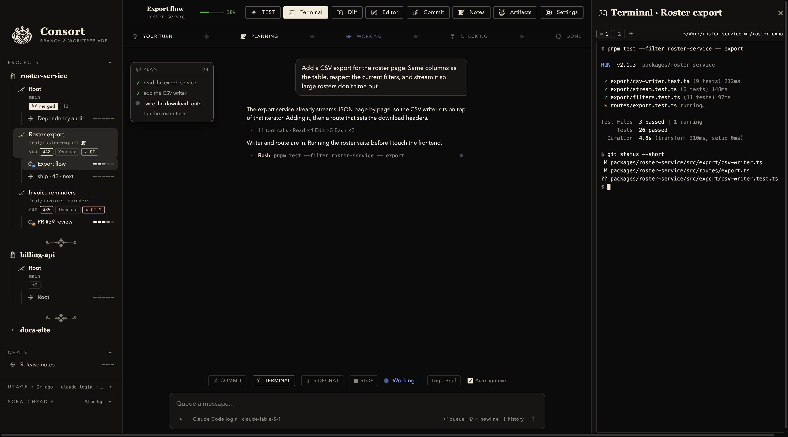
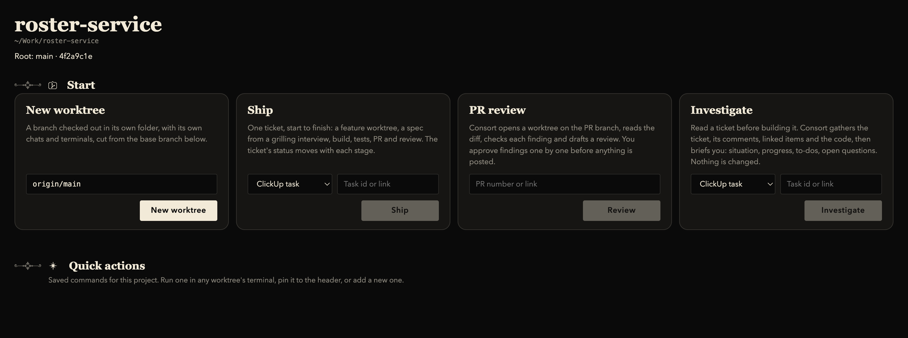
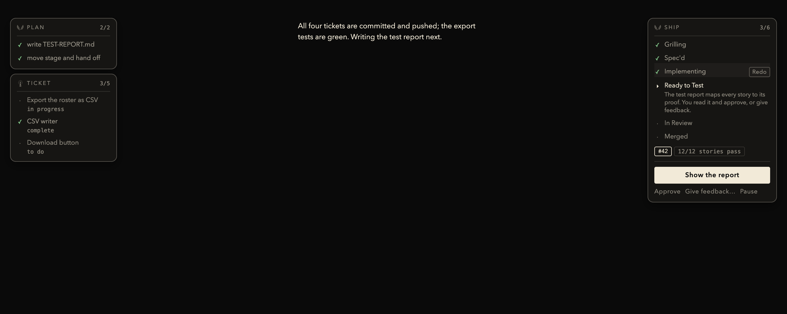
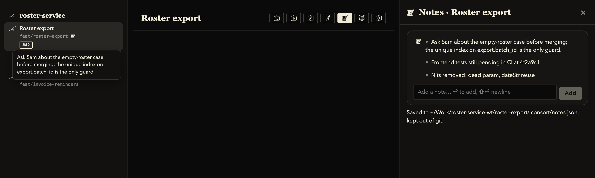

<p align="center">
  
</p>

<h1 align="center">Consort</h1>

<p align="center"><b>A branch- and worktree-oriented agentic development environment.</b><br>
Every task gets its own git worktree. AI coding agents work there, never in your main checkout.<br>
Chats, terminals, diffs, commits, PR review and ticket-to-merge shipping, in one desktop app.</p>

<p align="center">
  <a href="#install">Install</a> ·
  <a href="#what-you-get">Features</a> ·
  <a href="docs/FLOWS.md">Flows</a> ·
  <a href="docs/ship.md">/ship</a> ·
  <a href="CONTRIBUTING.md">Contributing</a>
</p>

---



*Three projects in the sidebar, each with its root checkout and feature worktrees. The agent is building a CSV export in its own worktree, with its plan at the left and the test run in the terminal drawer. The sidebar dots and phase strip say what is running and when it is your turn.*

## Why worktrees

An agent that edits your working copy competes with you for the same files, branch and build. Consort gives every piece of work its own `git worktree` in its own folder: the agent builds there, you keep working at the repository root, and a worktree becomes a PR, gets checked out at root, or is thrown away. Many chats per worktree, many worktrees per project.

## What you get

**Projects and worktrees**
- Add any git repository. Its root checkout, every worktree and every chat sit in one sidebar.
- New worktree from a branch name, an issue, a PR, or a ticket. Push and check out at root when it is ready.
- Multi-repo workspaces: one chat scope across several checkouts, one commit and one set of PRs.

**Agents**
- Claude Code and Codex, through your CLI logins or API keys. Pick connector and model per chat; add a second login for another account.
- Model lists come from the providers' own APIs on every launch, and Consort fetches a newer Claude Code or Codex binary itself when a model needs it, so new models work without a new build.
- Every chat shows where the agent is (plan, phase, running tools) and when it is your turn. Permission prompts or auto-approve, per chat.
- Side chat: ask a read-only second agent about a long job while it runs.

**Shipping a ticket (`/ship`)**
- Start from a GitHub issue, a ClickUp task, or an idea. Consort cuts the branch and worktree, interviews you into a spec, breaks it into tickets, builds, verifies every story, opens the PR, reviews it, and moves the ticket's status at each stage.
- The SHIP card shows the stage you are at and what it does; the TICKET card shows the ticket and its sub-tasks as the tracker reports them. Redo any finished stage.

**PR review**
- An AI review that reads every changed file, verifies each finding, and writes a review document you rule on finding by finding. Only what you approve is posted to GitHub. Re-investigate a finding when the PR moves; fix one locally with a click.

**Investigate**
- Read a ticket before building it: the task, its comments, linked tasks, issues and PRs, and the code it touches, briefed as Situation, Progress so far, Remaining to-dos, Unanswered questions.

**Everyday tools**
- Terminals per worktree with saved quick actions. A file editor and a diff view. Commit and push with a generated message. Notes per worktree with one pinned beside the branch. A scratchpad that survives restarts.
- Everything Consort writes into your repo lands under `.consort/` and is kept out of git.

## More screens

Project page: four ways to start.



A `/ship` chat: PLAN and TICKET at the left, SHIP at the right with the next step.



Notes kept in the worktree, one pinned beside the branch.



The sidebar foot: plan usage per login, and a persistent scratchpad.


## Install

macOS (Apple silicon) today. Requires Node 22.12+, pnpm 9+, and Xcode command line tools for the native helper.

```bash
git clone https://github.com/mitchmeyer1/consort-ade.git
cd consort-ade
pnpm install
pnpm install:mac      # builds, packages and installs /Applications/Consort.app
```

For development:

```bash
pnpm dev
```

Then, in the app: **Connect agents** (Settings › AI connectors, sign in to Claude Code or Codex, or paste an API key) and **Add projects**.

Optional: a ClickUp API key in Settings › Ship enables shipping and investigating ClickUp tasks; an OpenRouter key enables Autopilot's desktop navigator.

## How it is built

Electron with a React renderer. Pure logic lives in `src/shared` and is tested with `node:test` against TypeScript directly; main-process modules take their outside world as injectable dependencies. See [CONTRIBUTING.md](CONTRIBUTING.md).

```bash
npx tsc --noEmit -p tsconfig.json
node --test 'tests/*.test.mjs'
```

## License

[MIT](LICENSE)
